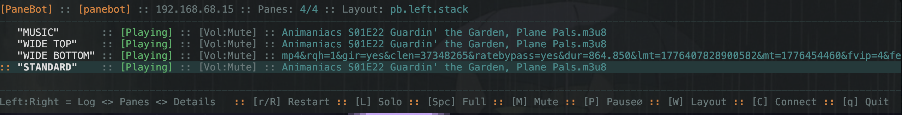

# PaneBot

PaneBot is a fast terminal-native operator client for
[`mpv-targets`](https://github.com/marlovious/mpv-targets). It connects to an
existing `mpv-targetsd` service and controls its named mpv targets through the
public client contract.

This branch is the next-generation PaneBot client. It replaces PaneBot's old
private daemon and protocol; the deployed v0.1 implementation remains available
in Git history and its existing release.



## What is included

- authoritative local or remote target state;
- target creation and lifecycle management;
- channel assignment;
- Solo and all-target play/pause controls;
- Dashboard command mode and mpv key passthrough;
- live playlist navigation, search, editing, loop/repeat, and managed-channel
  saving;
- automatic reconnect through the public `mpv_targets` client.

PaneBot is only the client. It does not contain or replace `mpv-targetsd`, and
it does not launch or supervise mpv processes.

## Run

An `mpv-targetsd` service must already be configured and running. Connect to a
specific service with:

```console
panebot --url wss://HOST:PORT
```

Without `--url`, PaneBot reads the standard mpv-targets configuration directory:

- `$XDG_CONFIG_HOME/mpv-targets`, when `XDG_CONFIG_HOME` is set;
- otherwise `~/.config/mpv-targets`.

It offers the local service described by `mpv-targets.toml` and the remote
services listed in `nodes.toml`.

```toml
[[nodes]]
id = "stage"
url = "wss://stage.example:9876"
```

## Build from source

```console
cargo build --release
```

The executable is written to `target/release/panebot`. Cargo downloads the
exact tested revision of the public `mpv_targets` client library recorded in
`Cargo.toml` and `Cargo.lock`; it does not select an untested latest revision.

Ordinary users can use prebuilt executables from GitHub Releases instead of
building from source.

## Product boundaries

The standalone PaneBot release is the client only. A separate macOS package may
later bundle PaneBot with `mpv-targetsd` for local installation without changing
the client architecture.

Layouts, the old local-log screen, legacy PaneBot daemon ownership, and legacy
configuration migration are not part of this client release.

The detailed behavior contract and implementation decisions are recorded in
[`SPEC.md`](SPEC.md) and [`BEHAVIOR_MATRIX.md`](BEHAVIOR_MATRIX.md).

## License

MIT
